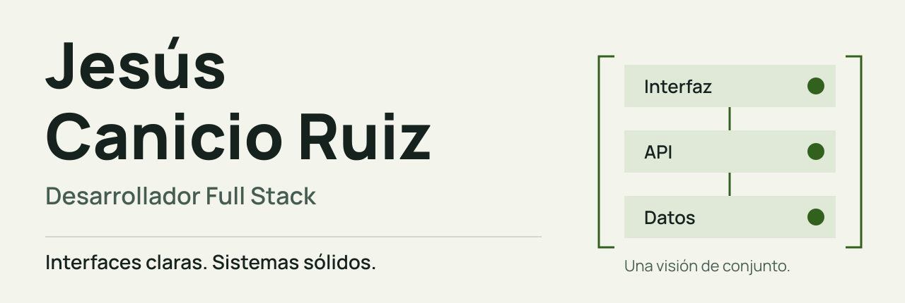
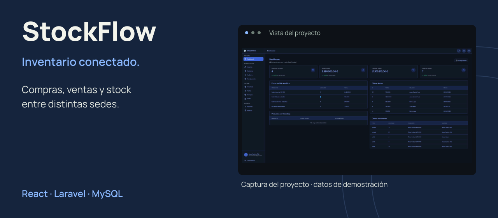
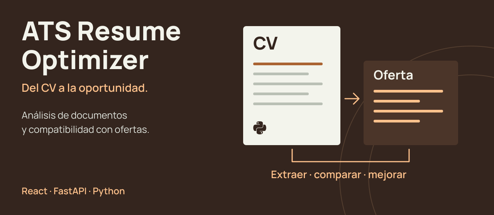
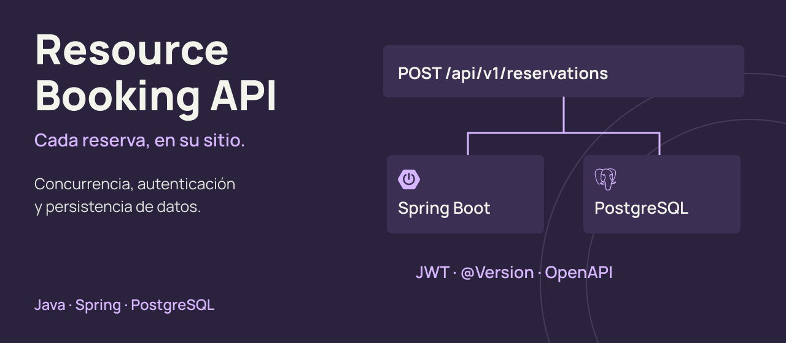
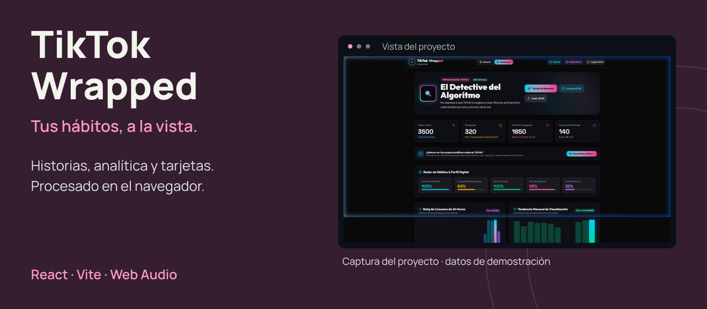
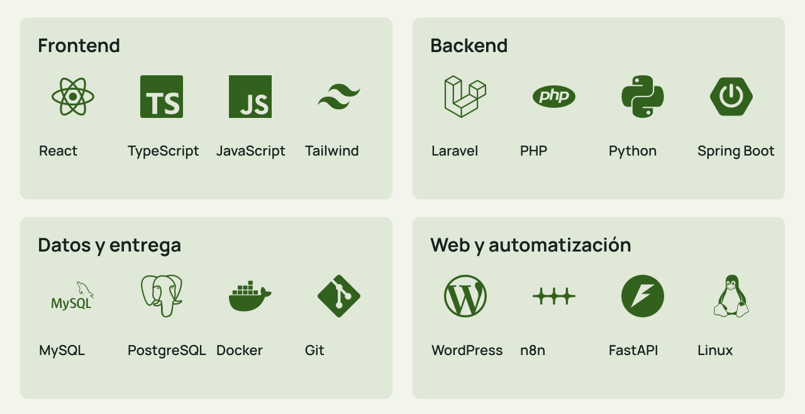
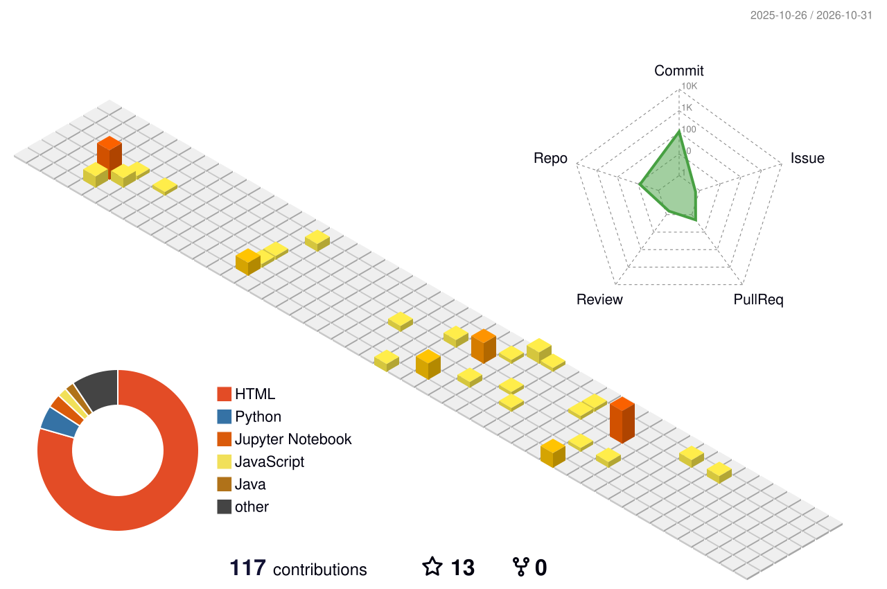
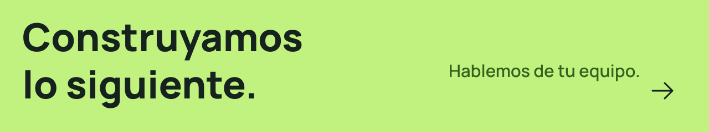

<picture>
  <source media="(max-width: 600px) and (prefers-color-scheme: dark)" srcset="assets/header-dark-mobile.svg">
  <source media="(max-width: 600px)" srcset="assets/header-light-mobile.svg">
  <source media="(prefers-color-scheme: dark)" srcset="assets/header-dark.svg">
  
</picture>

  
  
  

Desarrollador **Full Stack en Alicante**, actualmente en **Ángulo Tres**. Conecto interfaces, APIs y datos con React, Laravel, Python y Java. **Abierto a nuevas oportunidades en un equipo Full Stack.**

## Proyectos seleccionados

<a href="https://github.com/JesusCaRu/StockFlow_Gestor_de_inventario">
  <picture>
    <source media="(max-width: 600px)" srcset="assets/project-stockflow-mobile.svg">
    
  </picture>
</a>

[Ver código de StockFlow](https://github.com/JesusCaRu/StockFlow_Gestor_de_inventario) · Roles, permisos y movimientos de stock.

<a href="https://github.com/JesusCaRu/ats-resume-optimizer-ai">
  <picture>
    <source media="(max-width: 600px)" srcset="assets/project-ats-mobile.svg">
    
  </picture>
</a>

[Ver código del optimizador ATS](https://github.com/JesusCaRu/ats-resume-optimizer-ai) · Procesamiento de documentos e integración de IA generativa.

<a href="https://github.com/JesusCaRu/resource-booking-concurrency-api">
  <picture>
    <source media="(max-width: 600px)" srcset="assets/project-booking-mobile.svg">
    
  </picture>
</a>

[Ver código de la API de reservas](https://github.com/JesusCaRu/resource-booking-concurrency-api) · Evitar reservas incompatibles ante solicitudes simultáneas.

<a href="https://github.com/JesusCaRu/Tiktok-Wrapper">
  <picture>
    <source media="(max-width: 600px)" srcset="assets/project-tiktok-mobile.svg">
    
  </picture>
</a>

[Ver código de TikTok Wrapped](https://github.com/JesusCaRu/Tiktok-Wrapper) · [Probar la demo](https://tiktok-wrapper.vercel.app/)

**[Explorar todos los repositorios](https://github.com/JesusCaRu?tab=repositories)**

## Con qué trabajo

<picture>
  <source media="(max-width: 600px) and (prefers-color-scheme: dark)" srcset="assets/stack-dark-mobile.svg">
  <source media="(max-width: 600px)" srcset="assets/stack-light-mobile.svg">
  <source media="(prefers-color-scheme: dark)" srcset="assets/stack-dark.svg">
  
</picture>

  
Experiencia, formación y tecnologías en texto

Actualmente en **Ángulo Tres**, combino desarrollo web y comercio electrónico con plugins PHP, herramientas internas y automatización.

- **Interfaces:** React, TypeScript, JavaScript, HTML, CSS y Tailwind CSS.
- **Backend:** PHP y Laravel, Python y FastAPI, Java y Spring Boot.
- **Datos y entrega:** MySQL, PostgreSQL, MongoDB, Docker, Git y GitHub Actions.
- **Web y automatización:** WordPress, Bricks, plugins PHP, n8n y Linux.

Mi formación une **Desarrollo de Aplicaciones Web**, **Sistemas Microinformáticos y Redes** y una **especialización en Python**.

[Ver mi experiencia completa en el portfolio](https://porfolio-omega-puce.vercel.app/).

## Actividad en GitHub

<picture>
  <source media="(prefers-color-scheme: dark)" srcset="profile-3d-contrib/profile-night-green.svg">
  
</picture>

[Ver la última actualización del gráfico](https://github.com/JesusCaRu/JesusCaRu/actions/workflows/profile-3d.yml)

## Hablemos

<a href="mailto:jesuscanicio33@gmail.com">
  <picture>
    <source media="(max-width: 600px)" srcset="assets/contact-mobile.svg">
    
  </picture>
</a>

**[jesuscanicio33@gmail.com](mailto:jesuscanicio33@gmail.com)** · [LinkedIn](https://www.linkedin.com/in/jes%C3%BAs-canicio-ruiz-184374262/) · [Portfolio](https://porfolio-omega-puce.vercel.app/)
